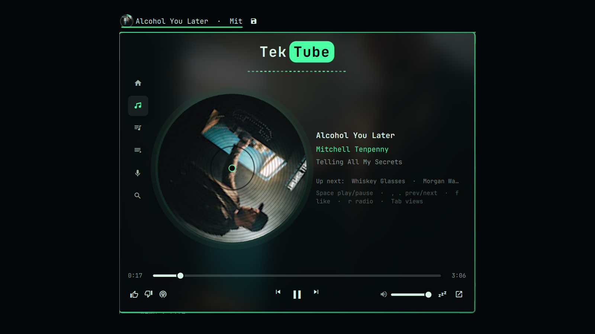
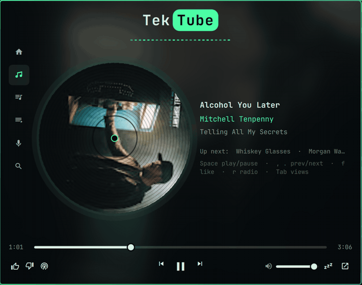
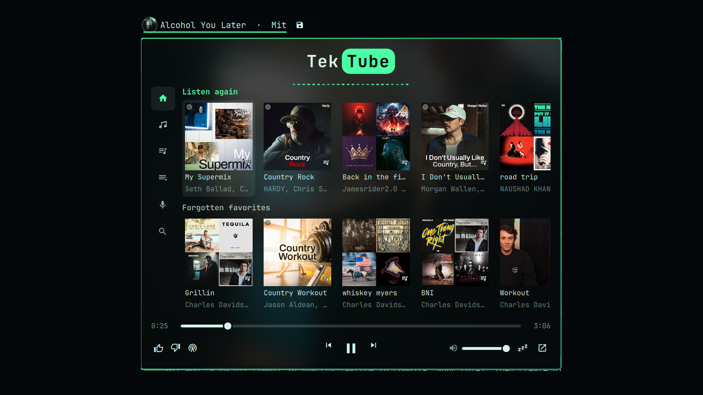
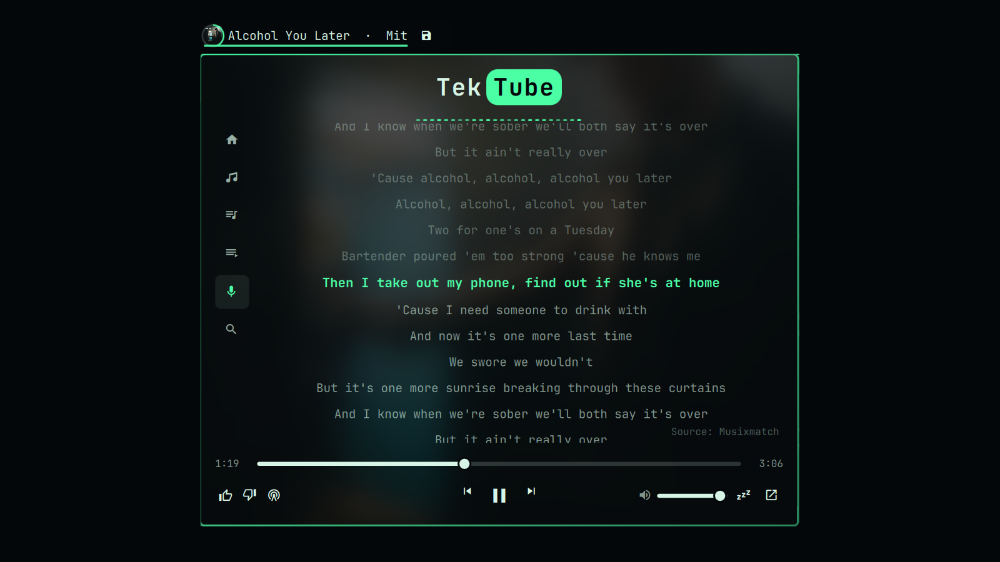
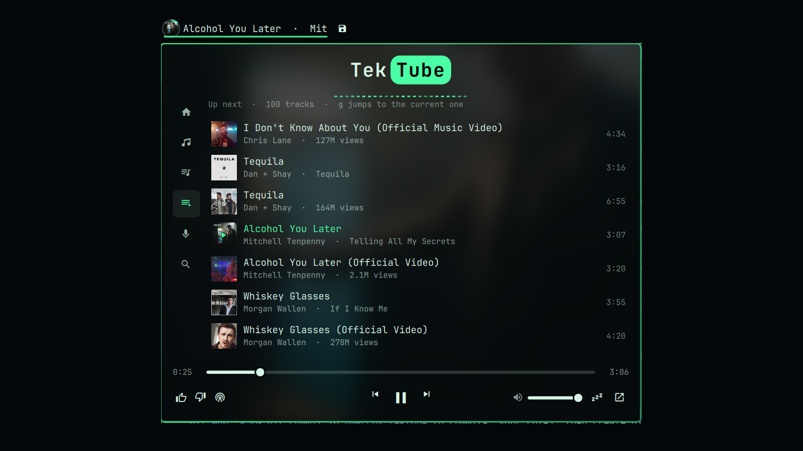
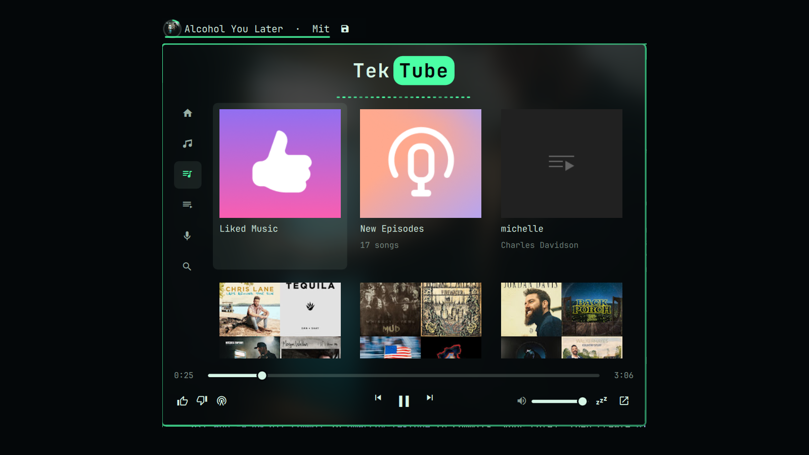
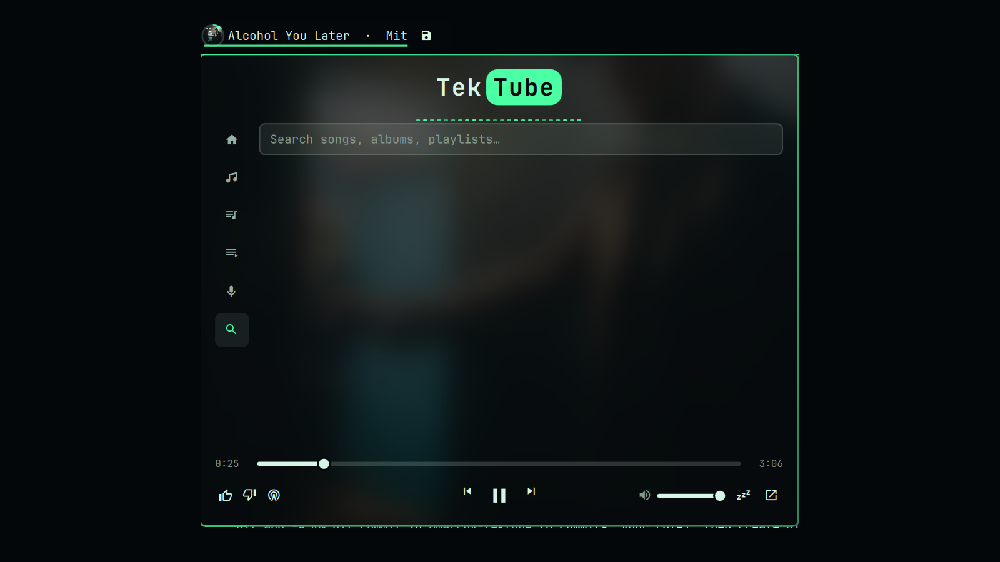

# TekTube — YouTube Music for Omarchy

Your real YouTube Music account in the Omarchy bar: your Home rows and mixes,
playlists and Liked Music, the queue, **synced lyrics**, like / dislike,
"start radio", search — drawn from your theme, driven from the keyboard, with
a spinning record and an ambient wash of the cover behind it all.



## Quick start

```sh
omarchy plugin add https://github.com/TIerTek/omarchy-tektube.git --enable
```

1. Click the new **TekTube** pill in the bar → **Open YouTube Music**.
2. The panel says you're not signed in → **Sign in with Google**. A normal
   browser window opens on Google's sign-in page. Sign in, then close it.
3. That's it. TekTube reopens by itself, signed in, loads your Home and
   library, and the window tucks itself away in a special workspace.

Needs a Chromium-family browser (Chrome, Brave, Chromium, Vivaldi, Edge) —
nothing else to install. Premium accounts get ad-free playback; media keys
work out of the box.

It works by driving a YouTube Music app window that you sign into yourself.
There is no API key to create, no cookie to paste, and nothing to break when
YouTube changes its stream formats: playback is the real player.

| Home | Lyrics | Queue |
|---|---|---|
|  |  |  |

| Playlists | Search |
|---|---|
|  |  |

## What you get

- **Bar pill** — artwork in a progress ring, title · artist. Left click
  opens the panel, middle click play/pause, right click next, scroll = volume.
- **Home** — YouTube's rows for *your* account: Listen again, Mixed for you,
  your Supermix, Quick picks, new releases. One click starts any of them.
  This is where the panel opens when nothing is playing.
- **Now playing** — the cover as a spinning record that eases to a stop when
  you pause, a glow tinted from the cover *and* your theme accent, up-next,
  optional spectrum bars (if `cava` is installed).
- **Living header** — the TekTube mark with an equalizer that breathes while
  playing (and follows the music when `cava` is present), over an ambient
  wash of the album art blurred behind the whole panel.
- **Playlists** — every playlist in your library including Liked Music; play,
  shuffle, or pick a track. Long playlists load completely.
- **Up next** — the live queue with the current track marked; jump anywhere.
- **Lyrics** — timed, highlighted line by line, click a line to seek; plain
  lyrics when the song has no timings.
- **Search** — songs, albums and playlists; Enter plays.
- **Account actions** — like, dislike, start radio from the current song.
- Track-change notification with artwork, a sleep timer, and the app window
  parked out of sight in a special workspace.

## Requirements

- Omarchy with the plugin system (Quickshell bar).
- A **Chromium-family browser**: Google Chrome, Brave, Chromium, Vivaldi or
  Edge. Firefox cannot be driven this way. Your default browser is used if it
  qualifies; otherwise the first one found. Set `browser` in the widget
  settings to pick one explicitly.
- Python 3 (standard library only — present on every Omarchy install).
- Optional: [`cava`](https://github.com/karlstav/cava) for the spectrum bars.

## Install

```sh
omarchy plugin add https://github.com/TIerTek/omarchy-tektube.git --enable
```

The widget lands in the left section of the bar. To move it:

```sh
omarchy bar move tiertek.ytm --section center
```

### First run

Click the pill, then **Open YouTube Music**. A YouTube Music window opens
with its own browser profile. While you're signed out, the panel offers
**Sign in with Google**.

Google won't let you sign in from the app window itself ("This browser or
app may not be secure") because the plugin drives that window over the
DevTools port. So **Sign in with Google** closes it and opens a normal
window on the same profile, without the debug port and with the address bar
showing `accounts.google.com`. Sign in there and close the window. TekTube
reopens the app on its own, now signed in, and the panel loads your library.
You won't be asked again; the session lives in that profile.

The window is then moved to the special workspace `ytm` so it stays out of
your way. Bring it back with the ↗ button in the panel, `Super+Shift+M`
(below), or `omarchy-shell`'s IPC — see **Controls**.

## Controls

| In the bar | |
|---|---|
| Left click | open / close the panel |
| Middle click | play / pause |
| Right click | next track |
| Scroll | volume |

| In the panel | |
|---|---|
| `Tab` / `Shift+Tab` | cycle views |
| `h` `n` `p` `q` `y` `/` | Home · Now playing · Playlists · Queue · Lyrics · Search |
| `↑ ↓ ← →` or `j k h l` | move; `←` backs out of a playlist |
| `Enter` / `Space` | play the selected item (Space = play/pause in Now playing) |
| `,` `.` | previous / next track |
| `f` `d` `r` | like · dislike · start radio from the current song |
| `t` | repeat: off → all → this song → off |
| `x` | shuffle on / off |
| `a` `s` | inside a playlist: play all · shuffle |
| `g` | queue / lyrics: jump back to the current line |
| `R` | Home: refresh the rows |
| `Esc` | close |

Desktop media keys work through MPRIS without any binding.

### Keybindings (optional)

Append `hypr/ytm.lua` from the plugin directory to `~/.config/hypr/bindings.lua`
and run `omarchy restart hyprland`. It binds `Super+M` (panel),
`Super+Shift+M` (show the window) and `Super+Alt+M` (lyrics). The same verbs
are available from any script through `bin/ytm`:

```sh
~/.config/omarchy/plugins/tiertek.ytm/bin/ytm toggle
~/.config/omarchy/plugins/tiertek.ytm/bin/ytm view lyrics
~/.config/omarchy/plugins/tiertek.ytm/bin/ytm playPause
```

## Settings

Edit them in the bar's widget settings or `~/.config/omarchy/shell.json`:

| key | default | |
|---|---|---|
| `browser` | `""` | executable name of a Chromium-family browser |
| `showWhenIdle` | `true` | keep the pill in the bar when nothing is playing |
| `toast` | `true` | notification on track change (quiet while the panel is open) |
| `autoRelaunch` | `false` | reopen the window automatically if it is closed |
| `parkWindow` | `true` | move the window to the `ytm` special workspace when it appears |
| `visualizer` | `true` | spectrum bars when `cava` is installed |
| `maxLabelWidth` | `180` | width of the bar label in pixels |

## How it works, and what it never does

TekTube is the name; the plugin id is `tiertek.ytm`.

`bin/ytm-app` launches the browser as an app window with a **dedicated
profile** (`~/.local/share/tiertek.ytm/profile`) and a DevTools port bound to
localhost on a random port. `bin/ytm-bridge` (Python, standard library)
attaches over that port, installs one function into the page (`bin/page.js`),
and serves a small JSON protocol on a private unix socket that the bar reads.

Every request for your data — playlists, queue, lyrics, likes — runs *inside
the page*, as the site's own JavaScript would, using the session the browser
already holds. The plugin never reads cookies, never stores a token, and has
no credential to leak. Playback control goes over MPRIS, the same interface
Omarchy's own media widget uses.

Your everyday browser profile is untouched and never debuggable: the port
belongs to the plugin's profile only. See [SECURITY.md](SECURITY.md).

Where things live:

| | |
|---|---|
| browser profile (your session) | `~/.local/share/tiertek.ytm/profile/` |
| cache (library snapshot, notification artwork) | `~/.cache/tiertek.ytm/` |
| socket | `$XDG_RUNTIME_DIR/tiertek.ytm.sock` (mode 0600) |

## Troubleshooting

The panel always tells you which state it is in and offers the one action
that fixes it:

| panel says | meaning |
|---|---|
| *Starting the bridge…* | the shell is starting `ytm-bridge`; give it a second. If it stays, `journalctl --user -f` shows `[tiertek.ytm]` lines. |
| *YouTube Music is not open* | no app window. Click **Open YouTube Music**. |
| *Connecting to YouTube Music…* | the window exists, the page is still loading. |
| *Not signed in to YouTube Music* | signed out. Click **Sign in with Google** (see **First run**). |
| *Sign in in the Google window, then close it…* | the plain sign-in window is open. Once you close it, TekTube reopens. |
| *YouTube changed something — playback still works* | a response shape moved. Transport keeps working over MPRIS; playlists come from the last good snapshot. Please open an issue with the endpoint name from the journal. |

If the pill shows nothing at all, check the plugin is enabled:
`omarchy plugin list | grep tiertek.ytm`.

## Update

```sh
omarchy plugin update tiertek.ytm
```

## Remove

```sh
omarchy plugin remove tiertek.ytm
```

This removes the plugin and stops the bridge. Your sign-in profile is left in
place so reinstalling does not ask you to log in again; to remove it too:

```sh
rm -rf ~/.local/share/tiertek.ytm ~/.cache/tiertek.ytm
```

If you appended `hypr/ytm.lua` to your bindings, delete the block between
`-- BEGIN tiertek.ytm` and `-- END tiertek.ytm`.

## Development

```sh
bash tests/run-all.sh          # launcher, bridge (against a fake DevTools), parsers, glow maths
omarchy plugin validate .
```

The bridge tests never touch a browser or the network: `tests/fakecdp.py`
speaks just enough of the DevTools protocol. InnerTube parsers are tested
against fixtures in `tests/fixtures/innertube/`, including a scrubbed capture
of the current flat search layout.

## License

MIT. See [LICENSE](LICENSE).
